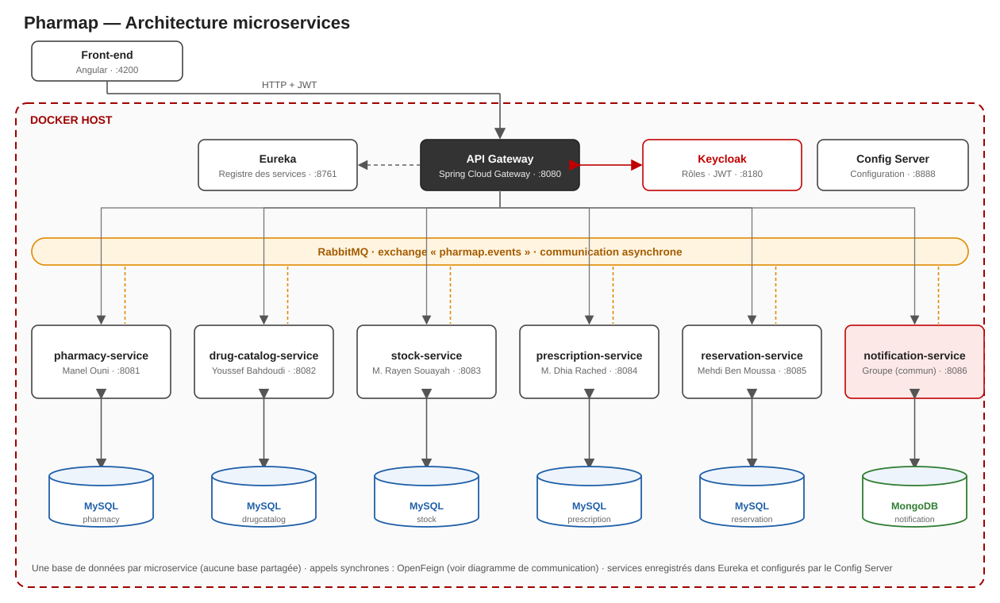

# 6. Architecture technique

Version Mermaid éditable : [`Diagrams/architecture.md`](Diagrams/architecture.md)

## Stack imposée (et respectée)

| Besoin | Technologie | Rôle dans Pharmap |
|---|---|---|
| Microservices | **Spring Boot** 4.1 / Java 17 | 6 services métier |
| API Gateway | **Spring Cloud Gateway** | Point d'entrée unique, routage `lb://`, CORS |
| Découverte | **Eureka** | Enregistrement et découverte des services |
| Configuration | **Spring Cloud Config** | Configuration partagée |
| Appels synchrones | **OpenFeign** + Resilience4j | Communication et tolérance aux pannes |
| Appels asynchrones | **RabbitMQ** (Spring AMQP) | Événements métier |
| Sécurité | **Keycloak** (OAuth2 / OpenID Connect) | Authentification, rôles, jetons JWT |
| Bases de données | **MySQL** (une par service) + **MongoDB** (MS6) | Données propres à chaque service |
| Documentation d'API | **Swagger / springdoc-openapi** | Contrat d'API de chaque service |
| Conteneurs | **Docker + Docker Compose** | Bases, broker, Keycloak, puis tous les services |
| Front-end | **Angular** | Application web des trois rôles |

## Flux d'une requête

1. Le front obtient un **jeton JWT** auprès de Keycloak (connexion).
2. Il appelle la **Gateway** avec le jeton ; la Gateway le valide et route la requête (`lb://service`) grâce à Eureka.
3. Le microservice vérifie le rôle (`@PreAuthorize`), traite la requête sur **sa** base et, si besoin, appelle d'autres services (OpenFeign) ou publie un événement (RabbitMQ).

## Sécurité (séance 8)

- Un realm `pharmap` avec trois rôles : `PATIENT`, `PHARMACIST`, `ADMIN`.
- Le pharmacien est rattaché à sa pharmacie par un *claim* du jeton (`pharmacyId`).
- Les services sont des *resource servers* qui valident le JWT ; les endpoints « internes » (hold, release, covers) ne sont accessibles que depuis le réseau des services.

## Ports

| Composant | Port |
|---|---|
| Front-end | 4200 |
| API Gateway | 8080 |
| pharmacy-service | 8081 |
| drug-catalog-service | 8082 |
| stock-service | 8083 |
| prescription-service | 8084 |
| reservation-service | 8085 |
| notification-service | 8086 |
| Eureka | 8761 |
| Config Server | 8888 |
| Keycloak | 8180 |
| RabbitMQ | 5672 (console 15672) |
| MySQL (par service) | 3307 à 3311 |
| MongoDB | 27017 |

## Lancement local

Voir le [README](../README.md) à la racine du dépôt.
