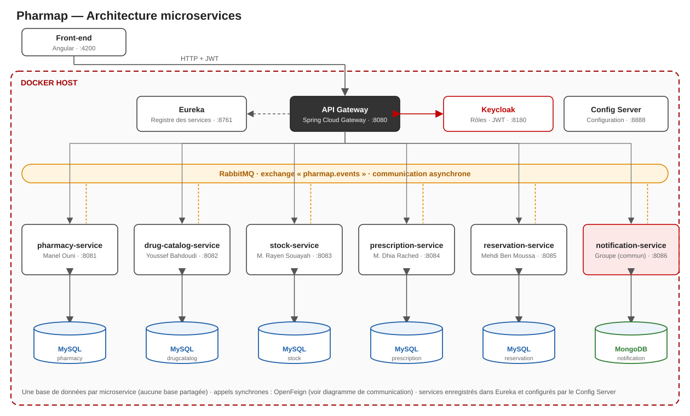

# Pharmap

> Trouvez et réservez vos médicaments dans les pharmacies proches de vous

Projet du module **AWD (Applications Web Distribuées)** : application web en **architecture microservices** (Spring Boot, Spring Cloud, Keycloak, Docker). Année universitaire 2026-2027.

## 1. Le sujet

En Tunisie, les pénuries de médicaments obligent les patients à faire le tour des pharmacies. Pharmap leur permet de **trouver** un médicament en stock près de chez eux, de le **réserver**, de déposer leur **ordonnance** et d'être **alertés** d'un retour en stock. Les pharmaciens publient leur stock et traitent réservations et ordonnances.

Acteurs : **Patient**, **Pharmacien**, **Administrateur**. Détails : [Documentation/01-sujet-acteurs-fonctionnalites.md](Documentation/01-sujet-acteurs-fonctionnalites.md)

## 2. L'équipe

| Membre | Microservice | Base |
|---|---|---|
| Manel Ouni | `pharmacy-service` | MySQL |
| Youssef Bahdoudi | `drug-catalog-service` | MySQL |
| Mohamed Rayen Souayah | `stock-service` | MySQL |
| Mohamed Dhia Rached | `prescription-service` | MySQL |
| Mehdi Ben Moussa | `reservation-service` | MySQL |
| Groupe | `notification-service` (commun) | MongoDB |

## 3. Architecture



| Composant | Technologie | Port |
|---|---|---|
| API Gateway | Spring Cloud Gateway | 8080 |
| Eureka | Spring Cloud Netflix Eureka | 8761 |
| Config Server | Spring Cloud Config | 8888 |
| Keycloak | Keycloak 26 | 8180 |
| RabbitMQ | RabbitMQ 3.13 | 5672 / 15672 |
| pharmacy-service | Spring Boot · MySQL | 8081 |
| drug-catalog-service | Spring Boot · MySQL | 8082 |
| stock-service | Spring Boot · MySQL | 8083 |
| prescription-service | Spring Boot · MySQL | 8084 |
| reservation-service | Spring Boot · MySQL | 8085 |
| notification-service | Spring Boot · MongoDB | 8086 |

- Communication **synchrone** : OpenFeign + Resilience4j (circuit breaker, fallback).
- Communication **asynchrone** : RabbitMQ (exchange `pharmap.events`).

## 4. Structure du dépôt

```
Backend/            un projet Maven par microservice + eureka-server, config-server, api-gateway
Frontend/           application Angular
Documentation/
  Presentation/     support de présentation
  Diagrams/         architecture, cas d'utilisation, données, séquences (Mermaid + SVG)
  0X-*.md           dossier de conception
docker-compose.yml  bases de données, RabbitMQ, Keycloak
```

## 5. Documentation de conception

| | |
|---|---|
| [Checklist séance 4](Documentation/00-checklist-seance4.md) | où trouver chaque élément |
| [1. Sujet, acteurs, fonctionnalités](Documentation/01-sujet-acteurs-fonctionnalites.md) | |
| [2. Découpage en microservices](Documentation/02-decoupage-microservices.md) | |
| [3. Données par service](Documentation/03-donnees.md) | |
| [4. Interactions](Documentation/04-interactions.md) | synchrone / asynchrone |
| [5. API REST](Documentation/05-api-rest.md) | endpoints |
| [6. Architecture technique](Documentation/06-architecture.md) | stack, sécurité, ports |
| [7. Organisation, planning, risques](Documentation/07-organisation-planning-risques.md) | |

## 6. Lancer le projet en local

**Prérequis** : JDK 17, Maven 3.9+ (ou les `mvnw` fournis), Docker Desktop, Node.js (pour le front).

```bash
# 1. Infrastructure : choisir ce dont on a besoin...
docker compose up -d mysql-pharmacy rabbitmq     # exemple pour pharmacy-service
# ... ou tout démarrer
docker compose up -d

# 2. Infrastructure Spring Cloud (dans cet ordre, depuis l'IDE ou en ligne de commande)
cd Backend/eureka-server && ./mvnw spring-boot:run     # http://localhost:8761
cd Backend/config-server && ./mvnw spring-boot:run     # http://localhost:8888
cd Backend/api-gateway   && ./mvnw spring-boot:run     # http://localhost:8080

# 3. Un microservice (exemple)
cd Backend/pharmacy-service && ./mvnw spring-boot:run # Swagger : http://localhost:8081/swagger-ui.html
```

Chaque microservice démarre **seul** : Eureka et le Config Server sont optionnels en développement. Les services dépendant d'autres services sont testés avec des *stubs* (voir [CONTRIBUTING.md](CONTRIBUTING.md)). Les tests (`./mvnw test`) n'ont besoin d'aucune infrastructure (H2 en mémoire).

**Port déjà utilisé ?** Chaque service lit son port dans la variable `SERVER_PORT` (ex. Oracle XE occupe souvent le 8080) : `SERVER_PORT=8088 ./mvnw spring-boot:run`. Mettre à jour le port du front en conséquence.

La dockerisation complète (un seul `docker compose up` pour tout) est prévue en séance 9.

## 7. Organisation

Gestion de projet : **GitHub Projects** (Kanban). Workflow Git et conventions : [CONTRIBUTING.md](CONTRIBUTING.md). Planning et risques : [Documentation/07-organisation-planning-risques.md](Documentation/07-organisation-planning-risques.md).

| Séance | Étape |
|---|---|
| S4 | Validation de la conception *(étape actuelle)* |
| S5 | CRUD + API Gateway |
| S6 | Communication synchrone |
| S7 | Communication asynchrone |
| S8 | Sécurité Keycloak |
| S9 | Dockerisation |
| S10 | Soutenance |
